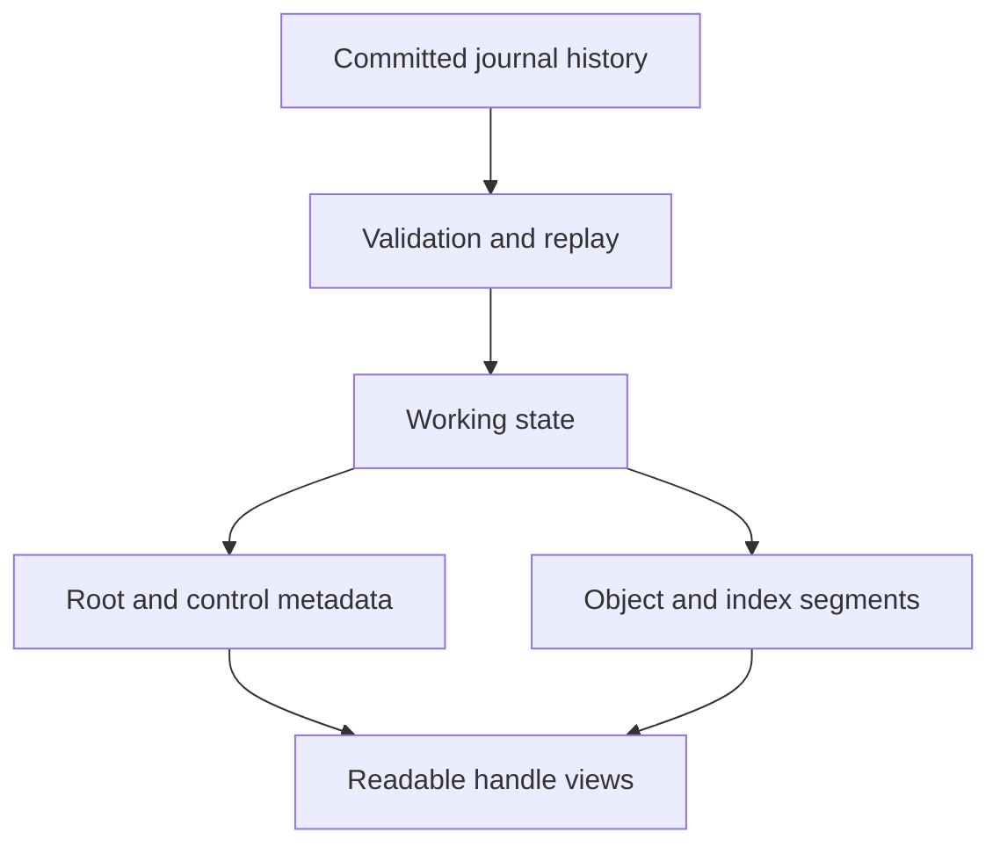

# Storage, journals and recovery

Point a `Catalog` at a directory, then create a named database there. Gyldan
creates and manages the native files used to store its history and readable
state. Save the example as `storage.py` and run `python storage.py` in a
fresh directory on a filesystem that supports durable creation, such as local
NTFS on Windows.

```python
from gyldan_shared import Catalog

catalog = Catalog("./storage-data")
with catalog.create("library") as database:
    root = database.get_handle("main")
    print(database.database_id())
```

The example prints the new database's UUID.
The file-backed provider places its native database directory under
`storage-data/.gyldan`. One catalog can contain several named databases. File
headers identify their database, logical unit, role and format, so applications
select databases through the catalog API.

## Logical layers and physical files

The root handle and each child handle are separate logical units. Each has its
own journal, writer lock and mapped working state. Creating child handles
therefore creates additional managed files. The child also records its parent
relationship and the ancestry needed to interpret its changes.

A layer is a logical set of changes in the database. A segment is a physical
file containing allocated storage. One layer can use multiple segment files as
its allocations grow.

| Managed file role | Purpose |
| --- | --- |
| Journal | Stores the logical records and commit information from which the unit's history can be replayed |
| Unit root or control file | Identifies and publishes the current mapped working state |
| Segment files | Hold allocated objects and indexes for that working state |
| Lock state | Coordinates the writer and database-open authority |
| Diagnostic logs, when enabled | Record operational messages for inspection |

Filenames and byte layouts are provider-managed. Treat the complete catalog's
native files as a managed group when moving or copying stored data.

## The journal records committed history

The journal is authoritative for logical model history. It records accepted
schema and value effects, their identities and transaction boundaries. Native
framing and integrity checks let recovery distinguish complete transactions
from incomplete tails.



The mapped working state is derived from a validated journal prefix. It speeds
ordinary reads by providing object and index structures that the provider can
map into memory. Metadata records which journal position the working state
represents.

## Segments hold the working state

Allocations are placed in segments. As the unit grows, allocation moves to later
segments. Older segments can be sealed with their exact used extent and
integrity information. Historical views retain the roots and ancestry needed
to read their selected state.

A transaction builds a private candidate while published readers keep their
prior state. Publication coordinates its roots and journal position so readers
receive one coherent state. Rollback abandons the private candidate. Later
transactions can reuse speculative allocation space.

## Reopening after interruption

A writable open examines the journal and working state. If their admitted
positions differ, it can replay committed history to bring the working state up
to date. If a derived working state needs reconstruction, the controller can
build and validate a replacement, then activate it.

An interrupted process can leave an unfinished transaction or an incomplete
tail. Recovery uses the journal's commit boundaries and integrity rules to
decide what can be applied. A failure reported during commit can leave the
outcome uncertain. Check that transaction's outcome before retrying its
application operation.

A read-only open can serve an earlier published working state while writable
recovery remains to be done. It is therefore insufficient to settle an
uncertain commit. See [operations and errors](operations.md#commit-outcomes).

Durability also depends on the filesystem and storage device honoring the
required flush operations. [Creation support](operations.md#filesystem-creation-support)
explains the explicit ReFS best-effort route and its directory-persistence
limit.

## History, memory and storage growth

Gyldan retains committed history and currently has substantial memory and disk
costs. Each change can add journal records, new object and index allocations,
publication metadata and historical state. Mapped segments and runtime metadata
also contribute to process memory use. Retaining Python objects, queries and
historical views can keep their owning session and captured state alive.

Automatic reclamation of committed segment space and journal compaction are
deferred in the current alpha. Repeated edits can grow the database even when
the number of current objects is unchanged. This release is intended for
evaluating behavior and APIs with those retention costs understood.

Measure memory and disk growth with the history and session lengths your
application needs. Close sessions that are finished, and obtain fresh handles
when reopening. Deleting a file individually can break the identities and
history relationships that recovery expects; let the provider manage its files.
